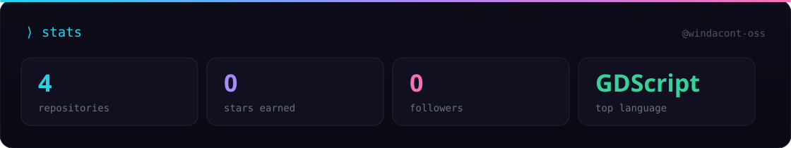
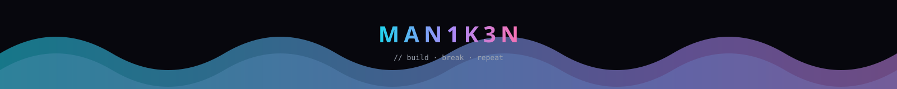

 

  

## `⟩ whoami`

Пишу игры — и иногда разбираю их на запчасти. Основное: **Godot + GDScript**, параллельно копаю **Unity**. Люблю докопаться до того, как всё устроено внутри.

- 🎮 **Проекты:** [counter-strike](https://github.com/windacont-oss/counter-strike) · [unityGAME](https://github.com/windacont-oss/unityGAME) · [pyraria](https://github.com/windacont-oss/pyraria) · [JARVIS](https://github.com/windacont-oss/JARVIS)
- 🔭 **Сейчас:** геймплейные прототипы и эксперименты с движками
- 🧩 **Интересно:** gamedev, game feel, tooling, low-level
- ⚡ **Принцип:** `build · break · repeat`

## `⟩ stack`

## `⟩ stats`

  
  

## `⟩ contributions`

<picture>
  <source media="(prefers-color-scheme: dark)" srcset="https://raw.githubusercontent.com/windacont-oss/windacont-oss/output/snake-dark.svg" />
  <source media="(prefers-color-scheme: light)" srcset="https://raw.githubusercontent.com/windacont-oss/windacont-oss/output/snake.svg" />
  
</picture>

 

